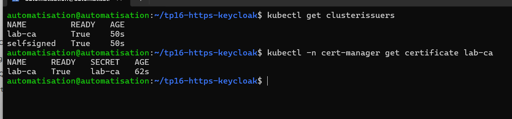
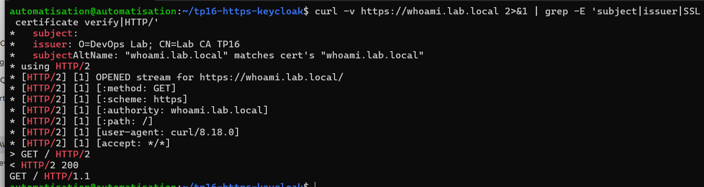
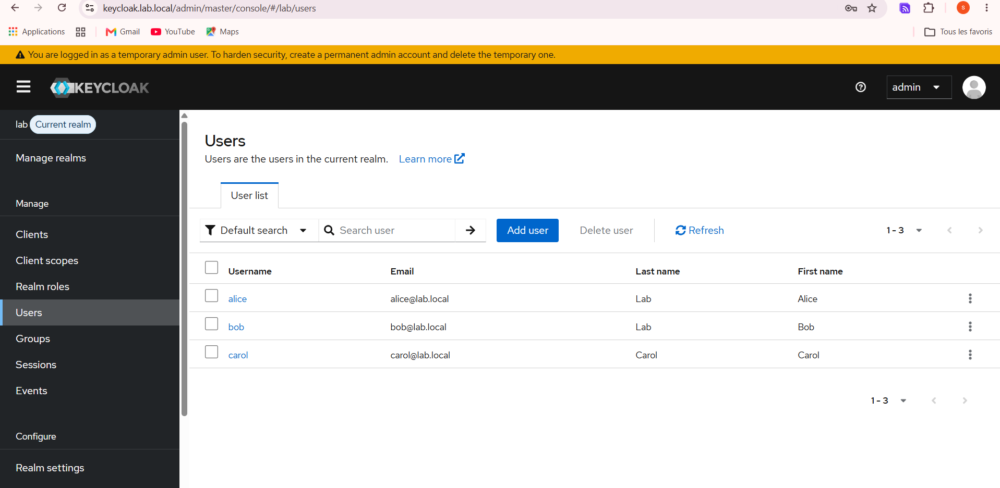
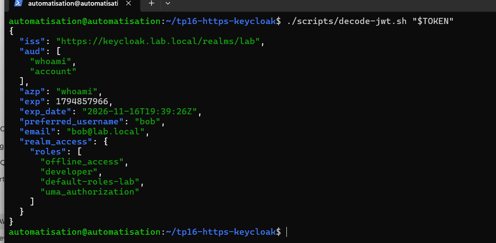
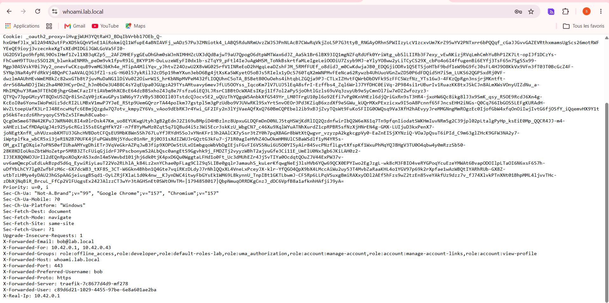
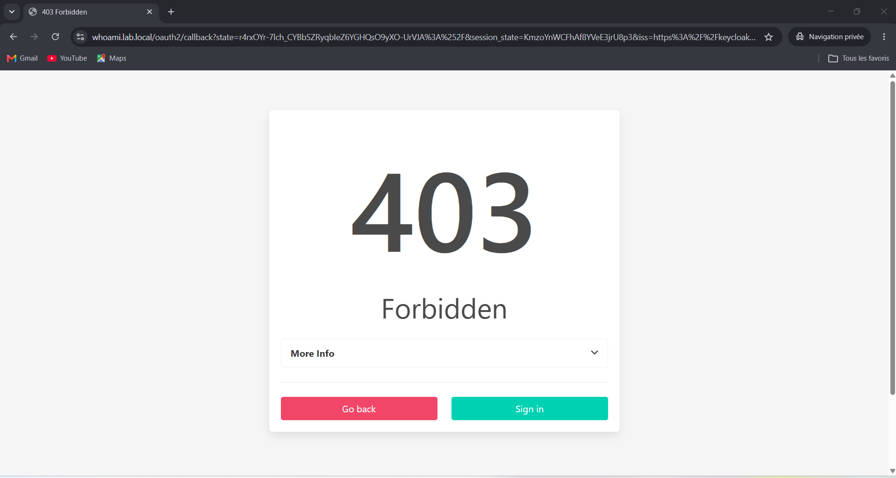

# TP16 : HTTPS avec cert-manager et IAM avec Keycloak (OIDC)

Une CA de lab gérée par cert-manager signe automatiquement les certificats des Ingress. Keycloak (realm `lab`) authentifie les utilisateurs, et oauth2-proxy protège `whoami` sans modifier son code : seuls les rôles `developer` et `admin` passent.
Les réponses aux questions sont dans [REPONSES.md](REPONSES.md).

```
.
├── captures/
├── manifests/
│   ├── 00-app.yaml               ← namespace tp16 + whoami
│   ├── 05-coredns-custom.yaml    ← keycloak.lab.local résolu dans le cluster
│   ├── 10-issuers.yaml           ← selfsigned → Certificate lab-ca → ClusterIssuer lab-ca
│   ├── 20-ingress-tls.yaml       ← Ingress HTTPS (websecure + tls)
│   ├── 30-keycloak.yaml          ← Keycloak 26 + PVC + Ingress HTTPS
│   ├── 40-oauth2-proxy.yaml      ← oauth2-proxy (allowed-role developer/admin)
│   └── 41-ingress-oauth2.yaml    ← Ingress whoami → oauth2-proxy
├── scripts/
│   ├── keycloak-setup.sh         ← option rapide : realm/rôles/users/client en CLI
│   ├── get-token.sh              ← jeton via le flux password
│   └── decode-jwt.sh             ← décodage du payload d'un JWT
└── defi/express-jwt/             ← middleware Express qui valide le JWT (JWKS, iss, aud, exp, rôle)
```

**Jamais dans Git** : la clé privée de la CA (`tls.key`), le secret du client, le cookie-secret et le mot de passe admin. Ils restent dans des Secrets Kubernetes créés en ligne de commande.

## 0. Préparation

Keycloak a besoin d'environ 1 Go de RAM. Libérer de la place et retirer les anciens Ingress `whoami.lab.local` :

```bash
free -m
(cd ~/harbor-install/harbor && sudo docker compose stop)        # Harbor (TP12/15), relançable avec "start"
helm uninstall whoami -n tp15 2>/dev/null; helm uninstall whoami-oci -n tp15-oci 2>/dev/null
kubectl delete ns tp15 tp15-oci tp15-dev tp15-staging tp15-prod tp14 --ignore-not-found
kubectl get ingress -A                                          # plus aucun whoami.lab.local

sudo apt install -y jq
grep -q keycloak.lab.local /etc/hosts || echo "127.0.0.1 keycloak.lab.local" | sudo tee -a /etc/hosts
grep -E 'whoami|keycloak' /etc/hosts

kubectl apply -f manifests/00-app.yaml
```

## 1. Partie 1 : cert-manager et CA de lab

```bash
helm repo add jetstack https://charts.jetstack.io && helm repo update
helm install cert-manager jetstack/cert-manager -n cert-manager --create-namespace \
  --version v1.21.3 --set crds.enabled=true
kubectl -n cert-manager rollout status deploy/cert-manager-webhook

kubectl apply -f manifests/10-issuers.yaml
kubectl get clusterissuers
kubectl -n cert-manager get certificate lab-ca
```

**Capture `clusterissuers.png`** : `selfsigned` et `lab-ca` en `READY True`, et le Certificate `lab-ca` `READY True`.

Exporter le certificat **public** de la CA et lui faire confiance sur la VM :

```bash
kubectl -n cert-manager get secret lab-ca -o jsonpath='{.data.ca\.crt}' | base64 -d > lab-ca.crt
openssl x509 -in lab-ca.crt -noout -subject -issuer -dates
sudo cp lab-ca.crt /usr/local/share/ca-certificates/lab-ca.crt && sudo update-ca-certificates
```

## 2. Partie 2 : Ingress HTTPS

```bash
kubectl apply -f manifests/20-ingress-tls.yaml
kubectl -n tp16 get certificate,certificaterequest
kubectl -n tp16 describe certificate whoami-tls | tail -15
curl -v https://whoami.lab.local 2>&1 | grep -E 'subject|issuer|SSL certificate verify|HTTP/'
```

**Capture `https-curl.png`** : `issuer: … CN=Lab CA TP16`, `SSL certificate verify ok` et la réponse de whoami.

```bash
openssl s_client -connect whoami.lab.local:443 -servername whoami.lab.local </dev/null 2>/dev/null \
  | openssl x509 -noout -text | grep -E -A1 'Subject Alternative|Not After'

kubectl -n tp16 delete secret whoami-tls
sleep 10
kubectl -n tp16 get secret whoami-tls ; kubectl -n tp16 get certificaterequest   # recréé automatiquement
kubectl -n tp16 get certificate whoami-tls -o jsonpath='{.spec.renewBefore}{"  "}{.status.renewalTime}{"\n"}'
```

## 3. Partie 3 : Keycloak

```bash
kubectl create namespace keycloak
kubectl -n keycloak create secret generic keycloak-admin --from-literal=password="$(openssl rand -base64 18)"

kubectl apply -f manifests/05-coredns-custom.yaml          # aucune IP à adapter : réécriture vers Traefik
kubectl -n kube-system rollout restart deploy/coredns
kubectl -n kube-system rollout status deploy/coredns

kubectl apply -f manifests/30-keycloak.yaml
kubectl -n keycloak rollout status deploy/keycloak --timeout=600s    # 2 à 5 min (JVM)
kubectl -n keycloak get certificate

kubectl -n keycloak get secret keycloak-admin -o jsonpath='{.data.password}' | base64 -d; echo
curl -s https://keycloak.lab.local/realms/master | jq .realm

# Test DNS depuis un Pod : doit répondre "lab" une fois le realm créé (Partie 4)
kubectl -n tp16 run dns --rm -it --image=busybox:1.37 --restart=Never -- nslookup keycloak.lab.local
```

Accès navigateur depuis Windows : voir la section 6.

## 4. Partie 4 : realm, rôles, utilisateurs, client

Dans la console `https://keycloak.lab.local/admin` (utilisateur `admin`) :

1. **Créer le realm** : menu des realms (en haut à gauche) → *Create realm* → `lab`.
2. **Rôles** : *Realm roles* → *Create role* → `user`, `developer`, `admin`.
3. **Utilisateurs** : *Users* → *Add user*, pour `alice`, `bob` et `carol` : username, **email** (`alice@lab.local`…), **Email verified : On**, first name, last name.
   * Onglet *Credentials* → *Set password* → **Temporary : Off**.
   * Onglet *Role mapping* → *Assign role* → filtrer par *realm roles* : alice → `admin`, bob → `developer`, carol → `user`.
4. **Client** : *Clients* → *Create client* → Client ID `whoami` → *Next* → **Client authentication : On**, **Standard flow** seul coché → *Next* → Valid redirect URIs `https://whoami.lab.local/oauth2/callback`, Web origins `https://whoami.lab.local` → *Save*.
   * Onglet *Client scopes* → `whoami-dedicated` → *Configure a new mapper* → **Audience** → nom `audience-whoami`, *Included Client Audience* `whoami`, *Add to access token* et *Add to ID token* : On → *Save*.
   * Onglet *Credentials* → copier le **Client secret**.

Option rapide (même résultat, en ligne de commande) : `LAB_PW='MotDePasse!123' ./scripts/keycloak-setup.sh`.

**Capture `keycloak-realm.png`** : realm `lab` avec la liste des *Realm roles* et celle des *Users* (deux captures si besoin).

Jeton de bob (flux password, uniquement pour l'observer) :

```bash
# Client whoami → Settings → Capability config → Direct access grants : On → Save
export CLIENT_SECRET='<secret du client>'  USER_PW='<mot de passe de bob>'
TOKEN=$(./scripts/get-token.sh bob)
./scripts/decode-jwt.sh "$TOKEN"
# Puis remettre Direct access grants : Off
curl -s https://keycloak.lab.local/realms/lab/.well-known/openid-configuration \
  | jq '{issuer, authorization_endpoint, token_endpoint, jwks_uri, end_session_endpoint}'
```

**Capture `jwt-decoded.png`** : `iss`, `aud` (contient `whoami`), `exp`, `preferred_username: bob`, `realm_access.roles` (contient `developer`).

## 5. Partie 5 : oauth2-proxy

```bash
kubectl -n tp16 create secret generic oauth2-proxy \
  --from-literal=client-secret="$CLIENT_SECRET" \
  --from-literal=cookie-secret="$(openssl rand -base64 32 | tr -- '+/' '-_' | head -c 32)"
kubectl -n tp16 create secret generic lab-ca-public --from-file=ca.crt=lab-ca.crt

kubectl apply -f manifests/40-oauth2-proxy.yaml
kubectl -n tp16 rollout status deploy/oauth2-proxy
kubectl apply -f manifests/41-ingress-oauth2.yaml          # l'Ingress whoami pointe vers oauth2-proxy
curl -sI https://whoami.lab.local | head -3                 # 302 vers keycloak.lab.local
kubectl -n tp16 logs deploy/oauth2-proxy --tail=5
```

Test dans le navigateur (section 6) :

* **bob** (ou alice) → la page whoami s'affiche avec `X-Forwarded-User` / `X-Forwarded-Email`. Dans les outils de développement (F12 → Réseau → la requête `whoami.lab.local` → en-têtes de **réponse**) : `X-Auth-Request-User`, `X-Auth-Request-Email`.
  **Capture `oauth2-allowed.png`**.
* **carol** (fenêtre de navigation privée) → `403 Forbidden`.
  **Capture `oauth2-403.png`**.
* Déconnexion : `https://whoami.lab.local/oauth2/sign_out`, puis revenir sur `https://whoami.lab.local` : on est reconnecté **sans mot de passe** (session SSO Keycloak, voir REPONSES.md).

## 6. Navigateur sous Windows

1. Copier la CA sur le PC (PowerShell) : `scp automatisation@192.168.190.141:~/tp16-https-keycloak/lab-ca.crt .`
2. Double-clic sur `lab-ca.crt` → *Installer le certificat* → *Utilisateur actuel* → *Placer tous les certificats dans le magasin suivant* → **Autorités de certification racines de confiance** → Terminer. Fermer et rouvrir le navigateur (Edge/Chrome. Firefox : `about:config` → `security.enterprise_roots.enabled = true`).
3. Bloc-notes **en administrateur** → `C:\Windows\System32\drivers\etc\hosts` → ajouter :
   `192.168.190.141 whoami.lab.local keycloak.lab.local`

## 7. Défis

* Middleware Express : `defi/express-jwt/` (voir son README) : signature via le JWKS, `iss`, `aud`, `exp`, et rôle `admin` pour `POST /api/admin`.
* ACME (step-ca / Pebble) : non réalisé.

## 8. Nettoyage

```bash
kubectl delete ns tp16 keycloak
helm uninstall cert-manager -n cert-manager
(cd ~/harbor-install/harbor && sudo docker compose start)
```

## Captures

**clusterissuers**



**https-curl**



**keycloak-realm**



**jwt-decoded**



**oauth2-allowed**



**oauth2-403**


